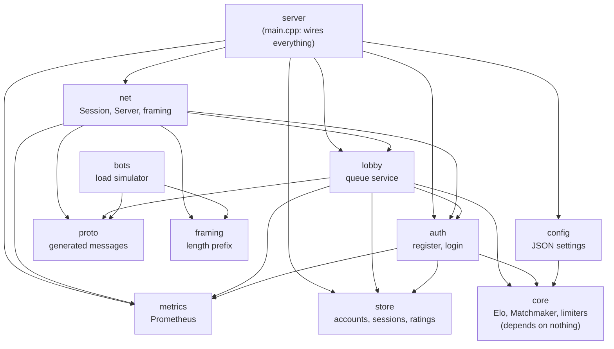
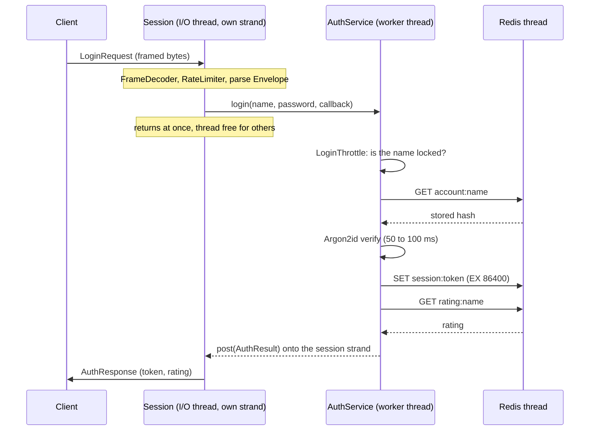
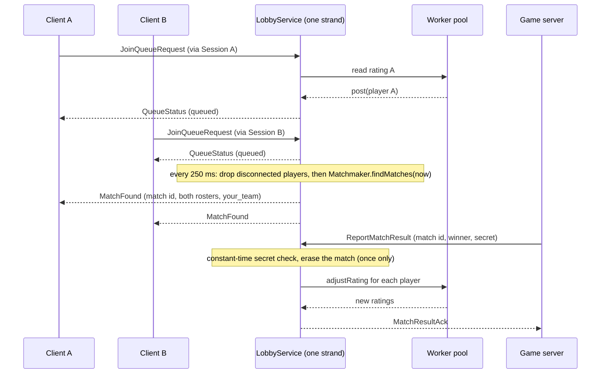
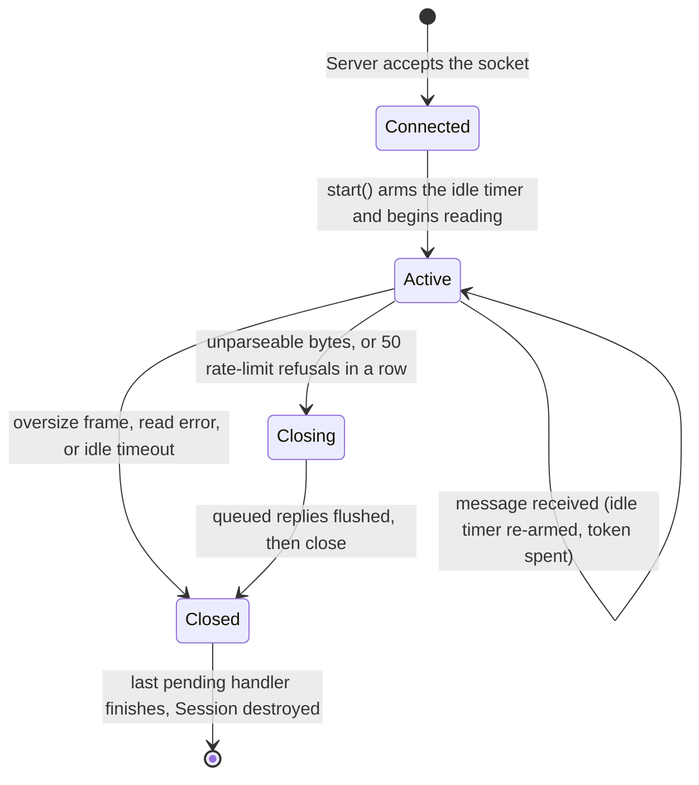

# matchforge file charts

Charts and tables for studying the project. [file-guide.md](file-guide.md) explains each file in
prose; this document is the quick-reference version: tables you can scan, diagrams you can
trace, and an index from each technique to the files that use it.

The diagrams use Mermaid, which GitHub draws automatically. In an editor without Mermaid
support, read the table next to each diagram instead.

**Contents**

1. How the libraries depend on each other (diagram)
2. Who runs on which thread (table)
3. Per-file charts: proto, core, store, auth, lobby, net, config, metrics, server, bots
4. Test charts: what tests what, and the test techniques
5. Runtime charts: messages, error codes, Redis keys, settings, environment variables, metrics
6. Sequence diagrams: login, and queue to rated result
7. Session lifecycle (state diagram)
8. Technique index: technique to files
9. Build, deploy and CI files

**Column guide for the per-file charts**

| Column | Meaning |
|---|---|
| Role | One line: what the file is for |
| Key techniques | The programming ideas used in it (explained in Part 8) |
| Uses (project) | Other project headers it includes. Taken from the real `#include` lines |
| Uses (libraries) | Third-party libraries it includes |
| Tests | Test file that covers it, and how many tests |

---

## 1. Library dependency diagram

An arrow `A --> B` means "A uses B". Arrows only point downward toward the simple parts:
`core` at the bottom depends on nothing. That is the rule from CLAUDE.md that keeps the
matching logic testable.

| Library | Built from | Third-party libraries |
|---|---|---|
| `matchforge_core` | `src/core/*.cpp` | none |
| `matchforge_proto` | generated from `proto/matchforge.proto` | Protobuf |
| `matchforge_framing` | `src/net/Framing.cpp` | none |
| `matchforge_store` | `src/store/*.cpp` | Boost.Redis, Boost.Asio, OpenSSL (headers only) |
| `matchforge_metrics` | `src/metrics/Metrics.cpp` | prometheus-cpp |
| `matchforge_auth` | `src/auth/*.cpp` | libsodium, spdlog, Boost.Asio |
| `matchforge_config` | `src/config/ServerConfig.cpp` | nlohmann-json |
| `matchforge_lobby` | `src/lobby/LobbyService.cpp` | Boost.Asio, spdlog |
| `matchforge_net` | `src/net/Session.cpp`, `Server.cpp` | Boost.Asio |
| `matchforge_botlib` | `src/bots/Bot*.cpp` | Boost.Asio |
| `matchforge_server` | `src/server/main.cpp` | spdlog, prometheus-cpp (HTTP endpoint) |
| `matchforge_bots` | `src/bots/main.cpp` | spdlog |
| `matchforge_tests` | `tests/**/*.cpp` | GoogleTest, plus all of the above |

---

## 2. Who runs on which thread

| Thread group | Count | Runs | Must never |
|---|---|---|---|
| I/O threads | one per CPU core, at least 2 | all network handlers, session timers, the lobby strand | block: no hashing, no Redis, no sleeping |
| Worker threads (`thread_pool`) | `workerThreads`, default 4 | Argon2id hashing, every Redis call, login throttle checks | touch a session's or the lobby's state directly |
| Redis I/O thread | 1 | the Boost.Redis connection | anything else |
| Prometheus HTTP threads | owned by prometheus-cpp | serve `/metrics` | none of ours |

| Object | Owns | How it is protected |
|---|---|---|
| each `Session` | its socket, write queue, decoder, rate limiter, idle timer, username | its own **strand**: handlers run one at a time |
| `LobbyService` | the `Matchmaker`, waiting connections, unreported matches, counters | **one strand**: other code posts to it |
| `AuthService` | the `LoginThrottle` | a **mutex** (workers run in parallel) |
| `InMemoryAccountStore` | maps of accounts, sessions, ratings | a **mutex** |
| `RedisAccountStore` | the Redis connection | its own **single thread**; callers hand work over with `post` |
| `Metrics` | counters, gauges, histogram | **atomics** inside prometheus-cpp |

---

## 3. Per-file charts

### 3.1 `proto/`

| File | Role | Key techniques | Uses | Tests |
|---|---|---|---|---|
| `matchforge.proto` | Defines the `Envelope` wrapper, its 11 payload messages, and two small helper messages | Protocol Buffers; `oneof` (a tagged union: exactly one payload); numbered fields that must never change; versioned package `matchforge.v1` | (none) | `EnvelopeTest` [1] |
| `proto/CMakeLists.txt` | Generates C++ from the `.proto` at build time | `add_custom_command` code generation; generated files kept in the build folder; static library with a PUBLIC include path | Protobuf `protoc` | built by every target that links it |

### 3.2 `src/core/`: pure logic

| File | Role | Key techniques | Uses (project) | Tests |
|---|---|---|---|---|
| `Version.h/.cpp` | Returns the project version | macro injected by CMake (`target_compile_definitions`); `std::string_view` | (none) | `VersionTest` [1] |
| `Validation.h/.cpp` | Username and password rules | pure functions; `constexpr` limits; character-range checks; length bounds to limit abuse | (none) | `ValidationTest` [5] |
| `Elo.h/.cpp` | Expected score and rating change | pure maths (`std::pow`, `std::lround`); default argument for K | (none) | `EloTest` [7] |
| `Matchmaker.h/.cpp` | The queue and the matching algorithm | **time passed in** (no clock inside); ordered `std::map`; sort with `std::tie` comparator; `try_emplace`; structured bindings; sliding window over a sorted list; snake draft; `enum class` results; constructor validation by exceptions | `core/Elo.h` | `MatchmakerTest` [14] |
| `RateLimiter.h/.cpp` | Token bucket for message rate | lazy refill (no timer); `std::chrono::duration<double>`; time passed in | (none) | `RateLimiterTest` [4] |
| `LoginThrottle.h/.cpp` | Lockout after repeated wrong passwords | `unordered_map` of per-name state; failure window plus lockout; size-triggered pruning against memory growth; time passed in | (none) | `LoginThrottleTest` [5] |
| `CMakeLists.txt` | Builds `matchforge_core` | static library; `PRIVATE` link to the warning flags | (none) | n/a |

### 3.3 `src/store/`: persistence

| File | Role | Key techniques | Uses (project) | Uses (libraries) | Tests |
|---|---|---|---|---|---|
| `AccountStore.h` | The storage contract: accounts, sessions, ratings | abstract class (pure `virtual`); virtual destructor; documented exceptions; atomic `adjustRating` in the contract | (none) | (none) | via both stores |
| `InMemoryAccountStore.h/.cpp` | RAM implementation for tests and local runs | `std::mutex` with `lock_guard`; `unordered_map`; expiry with `steady_clock`; `try_emplace` as "insert if missing"; `override` | `store/AccountStore.h` | (none) | `InMemoryAccountStoreTest` [6] |
| `RedisAccountStore.h/.cpp` | Redis implementation | own I/O thread kept alive by `executor_work_guard`; `std::promise` / `std::future` hand-off; `shared_ptr` state so a late reply is safe; 2-second `wait_for` timeout; member function template; Redis `SETNX`, `GET`, `SET ... EX`, `INCRBY`; two commands pipelined in one request; namespaced keys | `store/AccountStore.h` | Boost.Asio, Boost.Redis | `RedisAccountStoreTest` [4] (3 skip without Redis) |
| `BoostRedisSource.cpp` | Compiles Boost.Redis's implementation | separate-compilation unit (one `.cpp` that includes `src.hpp`) | (none) | Boost.Redis | n/a |
| `CMakeLists.txt` | Builds `matchforge_store` | `PUBLIC` link of Asio and Redis; OpenSSL for headers | (none) | n/a | n/a |

### 3.4 `src/auth/`: register and login

| File | Role | Key techniques | Uses (project) | Uses (libraries) | Tests |
|---|---|---|---|---|---|
| `PasswordHasher.h/.cpp` | Hash and verify passwords; make session tokens | Argon2id (`crypto_pwhash_str`); salted hash held in one string; cryptographically secure random bytes; URL-safe base64; `std::array` buffers; one-time `sodium_init` guard | (none) | libsodium | `PasswordHasherTest` [4] |
| `AuthService.h/.cpp` | Register and login on worker threads | work handed to a `thread_pool` with `post`; `std::function` callbacks; mutex-guarded shared throttle; **dummy hash** so unknown users cost the same time; identical error text for unknown user and wrong password; lowercase-normalised names; `try/catch` that turns storage errors into 503; nullable `Metrics*` | `auth/PasswordHasher.h`, `core/Validation.h`, `core/Elo.h`, `core/LoginThrottle.h`, `store/AccountStore.h`, `metrics/Metrics.h` | Boost.Asio, spdlog | `AuthServiceTest` [10] |
| `CMakeLists.txt` | Builds `matchforge_auth` | public and private link split | (none) | | n/a |

### 3.5 `src/lobby/`: the queue as a service

| File | Role | Key techniques | Uses (project) | Uses (libraries) | Tests |
|---|---|---|---|---|---|
| `LobbyClient.h` | How the lobby talks back to a player | interface; **dependency inversion** (the lower layer defines the contract, the network layer implements it) | (none) | (none) | via lobby tests |
| `LobbyService.h` | Declares the service, its settings and the state the strand owns | settings struct with defaults; state comments say which strand owns what | `core/Elo.h`, `core/Matchmaker.h`, `lobby/LobbyClient.h`, `store/AccountStore.h` | Boost.Asio | n/a |
| `LobbyService.cpp` | Join, leave, matching tick, announcements, results | **single strand owns all state**; `weak_ptr` to connections; `steady_timer` on the strand; hand-offs worker, strand, session with `post`; constant-time secret comparison; `owner_before` for connection identity; match erased on the strand so it can only be reported once; Elo from team averages; random match ids from the token generator | `lobby/LobbyService.h`, `auth/PasswordHasher.h`, `metrics/Metrics.h` | Boost.Asio, spdlog | `LobbyTest` [10] over TCP |
| `CMakeLists.txt` | Builds `matchforge_lobby` | | | | n/a |

### 3.6 `src/net/`: bytes, connections, listener

| File | Role | Key techniques | Uses (project) | Uses (libraries) | Tests |
|---|---|---|---|---|---|
| `Framing.h/.cpp` | Turn a byte stream into messages | length prefix; manual big-endian byte shifts; incremental decoder (a small state machine); a failure flag that never clears; `std::optional`; limit check before the body is read | (none) | (none) | `FramingTest` [7] |
| `Session.h` | One client connection's declaration | inherits `enable_shared_from_this` and `LobbyClient`; per-object strand; `SessionLimits` struct | `auth/AuthService.h`, `core/RateLimiter.h`, `lobby/LobbyClient.h`, `lobby/LobbyService.h`, `net/Framing.h` | Boost.Asio | n/a |
| `Session.cpp` | Read, decode, dispatch, reply, protect | `async_read_some` and `async_write`; `bind_executor` with the strand; write queue (one write at a time); `switch` over the `oneof` payload; idle timer re-armed on every message (cancel by resetting); token bucket; `closeAfterFlush` so errors reach the client; metrics in constructor and destructor | `net/Session.h`, `net/Framing.h`, `metrics/Metrics.h`, `matchforge.pb.h` | Boost.Asio | `ServerTest` [8], `SessionLimitsTest` [4] |
| `Server.h/.cpp` | Accept clients and start sessions | `acceptor`; recursive `async_accept`; `make_shared<Session>`; binding to port 0 to get a free port; the bind happens in the constructor so failures appear at startup | `net/Session.h`, `auth/AuthService.h`, `lobby/LobbyService.h` | Boost.Asio | `ServerTest` |
| `CMakeLists.txt` | Builds `matchforge_framing` and `matchforge_net` | splitting a library so clients avoid the server code | | | n/a |

### 3.7 `src/config/`

| File | Role | Key techniques | Uses (project) | Uses (libraries) | Tests |
|---|---|---|---|---|---|
| `ServerConfig.h` | The settings struct with defaults and the `ConfigError` type | plain struct with default member values; custom exception class | `core/Matchmaker.h` | (none) | n/a |
| `ServerConfig.cpp` | Parse and validate `server.json` | start from defaults, then overlay; helper templates `readInt`, `readDouble`, `readString`; **unknown keys rejected**; type and range checks; cross-field checks (`validate`); duplicate-name checks; `ifstream` and `stringstream` | `config/ServerConfig.h` | nlohmann-json | `ServerConfigTest` [9] |

### 3.8 `src/metrics/`

| File | Role | Key techniques | Uses | Tests |
|---|---|---|---|---|
| `Metrics.h` | The recording interface | forward declarations to keep headers light; reference members; non-copyable | (none) | n/a |
| `Metrics.cpp` | Creates each metric once and records values | prometheus-cpp registry; label families; counter, gauge, histogram; histogram bucket boundaries; atomics inside the library | prometheus-cpp | `MetricsTest` [3] |

### 3.9 `src/server/`

| File | Role | Key techniques | Uses (project) | Uses (libraries) | Tests |
|---|---|---|---|---|---|
| `main.cpp` | The composition root: builds every part in order and runs it | order of construction is the reverse order of destruction; command-line parsing; settings from config file, then flags, then environment; `signal_set` for SIGINT and SIGTERM; `io_context` run on a thread per core; explicit `workers.join()` before the store goes; exit codes 0 / 1 / 2 | `auth`, `config`, `core/Version.h`, `lobby`, `metrics`, `net/Server.h`, `store/RedisAccountStore.h` | Boost.Asio, spdlog, prometheus-cpp | end-to-end Docker run |

### 3.10 `src/bots/`

| File | Role | Key techniques | Uses | Tests |
|---|---|---|---|---|
| `BotOptions.h/.cpp` | Command-line parser | flag and value loop; range-checked `strtol`; `std::optional` result with the message in an out-parameter | (none) | `BotOptionsTest` [5] |
| `BotClient.h/.cpp` | Blocking protocol client | synchronous Asio; `resolver`; OS-level receive timeout (`SO_RCVTIMEO`); `waitFor` skips unrelated messages | `bots/BotClient.h`, `net/Framing.h`, `matchforge.pb.h` | `BotClientTest` [2] |
| `BotReport.h/.cpp` | Average and percentiles | sort, then nearest-rank percentile (`ceil`) | (none) | `BotReportTest` [3] |
| `main.cpp` | The simulator program | thread per bot; shared results guarded by a mutex; `std::mt19937`; `std::ref` and `std::cref`; one bot per match reports the result; non-zero exit on any failure | `bots/*`, `core/Version.h`, `matchforge.pb.h` | end-to-end Docker run |
| `CMakeLists.txt` | `matchforge_botlib` plus the executable | testable library split from `main` | | n/a |

---

## 4. Test charts

### 4.1 Which test covers which source file

| Source file | Test file | Tests | Kind |
|---|---|---|---|
| `core/Version` | `core/VersionTest.cpp` | 1 | unit |
| `core/Validation` | `core/ValidationTest.cpp` | 5 | unit |
| `core/Elo` | `core/EloTest.cpp` | 7 | unit |
| `core/Matchmaker` | `core/MatchmakerTest.cpp` | 14 | unit |
| `core/RateLimiter` | `core/RateLimiterTest.cpp` | 4 | unit |
| `core/LoginThrottle` | `core/LoginThrottleTest.cpp` | 5 | unit |
| `proto/matchforge.proto` | `proto/EnvelopeTest.cpp` | 1 | round trip |
| `auth/PasswordHasher` | `auth/PasswordHasherTest.cpp` | 4 | unit |
| `auth/AuthService` | `auth/AuthServiceTest.cpp` | 10 | unit with in-memory store |
| `store/InMemoryAccountStore` | `store/InMemoryAccountStoreTest.cpp` | 6 | unit |
| `store/RedisAccountStore` | `store/RedisAccountStoreTest.cpp` | 4 | 3 integration tests need Redis; 1 checks the Redis-down error without it |
| `net/Framing` | `net/FramingTest.cpp` | 7 | unit |
| `net/Server`, `net/Session` | `net/ServerTest.cpp` | 8 | integration over TCP |
| `net/Session` limits | `net/SessionLimitsTest.cpp` | 4 | integration over TCP |
| `lobby/LobbyService` | `lobby/LobbyTest.cpp` | 10 | integration over TCP, includes a 16-thread test |
| `metrics/Metrics` | `metrics/MetricsTest.cpp` | 3 | unit plus integration |
| `config/ServerConfig` | `config/ServerConfigTest.cpp` | 9 | unit, plus the shipped file |
| `bots/BotOptions` | `bots/BotOptionsTest.cpp` | 5 | unit |
| `bots/BotReport` | `bots/BotReportTest.cpp` | 3 | unit |
| `bots/BotClient` | `bots/BotClientTest.cpp` | 2 | integration over TCP |
| (shared helpers) | `net/TestSupport.h` | n/a | test infrastructure |
| **Total** | | **112** | |

By kind: 84 run with no setup at all (unit tests, plus the check that a Redis outage is
reported as an error), 25 are integration tests over real TCP, and 3 need a running Redis
(they skip themselves without one). The `core` library, which has no dependencies, has 36 of
the tests and runs in well under a second.

### 4.2 Testing techniques and where to see them

| Technique | Idea | Example |
|---|---|---|
| Time passed in | Tests choose "20 seconds later" without waiting | `MatchmakerTest`, `RateLimiterTest`, `LoginThrottleTest` |
| Boundary values | Test exactly at, just below, and just above each limit | `ValidationTest` (2, 3, 20, 21 characters), `FramingTest` |
| Hand-computed answers | Work the maths by hand, then assert the number | `EloTest` (1400 vs 1600 gives +24) |
| Property checks | Assert a rule that must always hold | `EloTest` zero-sum; `PasswordHasherTest` hashes differ; `LobbyTest` each player matched once |
| Round trip | Encode, decode, compare | `EnvelopeTest`, `FramingTest` |
| Interface fake | Use an in-memory store instead of Redis | `AuthServiceTest`, `ServerFixture` |
| Real sockets on loopback | Start the real server on a free port and talk to it | `ServerTest`, `LobbyTest` |
| Timeouts on every wait | A missing reply fails the test instead of hanging | `TestClient` receive timeout |
| Opt-in slow tests | `GTEST_SKIP` unless an environment variable is set | `RedisAccountStoreTest` |
| Concurrency test | Many threads at once, then check totals | `LobbyTest` (16 clients) |
| Security assertions | Errors never contain the password; unknown user looks like wrong password | `AuthServiceTest` |
| Failure injection | Point at a port nothing listens on | `RedisAccountStoreTest` (throws within 2 s) |
| Test the shipped file | The real config file must parse | `ServerConfigTest` |
| RAII test helpers | A thread object that always stops and joins | `IoThread` in `TestSupport.h` |

---

## 5. Runtime charts

### 5.1 Every message

| Message | Sent by | Needs login? | Handled in | Reply |
|---|---|---|---|---|
| `Heartbeat` | any client | no | `Session::handleFrame` | `Heartbeat` with the server clock |
| `RegisterRequest` | client | no | `AuthService::registerAccount` | `AuthResponse`, or `ErrorResponse` 400, 409, 503 |
| `LoginRequest` | client | no | `AuthService::login` | `AuthResponse`, or `ErrorResponse` 401, 429, 503 |
| `JoinQueueRequest` | logged-in client | yes (else 401) | `LobbyService::join` | `QueueStatus{queued}`, later `MatchFound`; or 400, 409, 503 |
| `LeaveQueueRequest` | logged-in client | yes (else 401) | `LobbyService::leave` | `QueueStatus{queued=false}`, or 409 |
| `ReportMatchResult` | game server | no, needs the **secret** | `LobbyService::reportResult` | `MatchResultAck`, or 400, 403, 404, 503 |
| `ErrorResponse`, `AuthResponse`, `QueueStatus`, `MatchFound`, `MatchResultAck` | server only | | | a client sending one gets 400 and stays connected |

### 5.2 Every error code

| Code | Meaning | Produced by |
|---|---|---|
| 400 | bad request | `Session` (unparseable bytes, which then close the connection; or a server-only message), `AuthService` (bad username or password format), `LobbyService` (unknown mode or region, bad `winning_team`) |
| 401 | not logged in, or bad credentials | `Session` (queue request before login), `AuthService` (wrong password or unknown user: same text) |
| 403 | not allowed | `LobbyService` (wrong or missing result secret) |
| 404 | not found | `LobbyService` (unknown or already-reported match) |
| 409 | conflict | `AuthService` (name taken), `LobbyService` (already queued; queued from another connection) |
| 429 | too many requests | `Session` (rate limit), `AuthService` (username locked) |
| 503 | storage unavailable | `AuthService`, `LobbyService` (Redis down or timed out) |

### 5.3 What is stored in Redis

| Key | Value | Written by | Read by | Lifetime |
|---|---|---|---|---|
| `account:<name>` | Argon2id hash string | `createAccount` (`SETNX`) | `findPasswordHash` (`GET`) | permanent |
| `session:<token>` | username | `saveSession` (`SET ... EX 86400`) | `findSessionUser` (`GET`) | 24 hours |
| `rating:<name>` | Elo number as text | `saveRating` (`SET`), `adjustRating` (`SETNX` then `INCRBY`) | `findRating` (`GET`) | permanent |

### 5.4 Settings in `config/server.json`

| Setting | Default | Used by | Effect |
|---|---|---|---|
| `port` | 7777 | `Server` | game port |
| `maxFrameBytes` | 65536 | `FrameDecoder` via `SessionLimits` | largest message accepted |
| `metricsPort` | 9100 | `main.cpp` (Prometheus exposer) | metrics endpoint; 0 turns it off |
| `workerThreads` | 4 | `main.cpp` (`thread_pool`) | hashing and Redis parallelism |
| `redis.host`, `redis.port` | 127.0.0.1, 6379 | `RedisAccountStore` | where Redis is |
| `matchmaking.tickMilliseconds` | 250 | `LobbyService` timer | how often matching runs |
| `matchmaking.baseRatingWindow` | 100 | `Matchmaker` | starting acceptable rating gap |
| `matchmaking.windowGrowthPerSecond` | 10 | `Matchmaker` | gap growth per second waited |
| `matchmaking.maxRatingWindow` | 600 | `Matchmaker` | gap never grows past this |
| `matchmaking.kFactor` | 32 | `LobbyService::reportResult` | size of rating changes |
| `matchmaking.regions` | eu, na, asia | `Matchmaker` | allowed regions |
| `matchmaking.modes` | duel 1, duo 2, squad 4 | `Matchmaker` | game modes and team sizes |
| `limits.idleTimeoutSeconds` | 60 | `Session` idle timer | close silent connections |
| `limits.messagesPerSecond` | 20 | `RateLimiter` | long-run message rate |
| `limits.messageBurst` | 40 | `RateLimiter` | short burst allowed |
| `limits.maxLoginFailures` | 5 | `LoginThrottle` | wrong passwords before a lock |
| `limits.loginLockoutSeconds` | 300 | `LoginThrottle` | used as both the counting window and the lock length |

### 5.5 Environment variables

| Variable | Read by | Meaning |
|---|---|---|
| `MATCHFORGE_REDIS_HOST`, `MATCHFORGE_REDIS_PORT` | `main.cpp` | override the Redis address from the config |
| `MATCHFORGE_RESULT_SECRET` | `main.cpp`, `docker-compose.yml`, bots `--secret` | shared secret for reporting results; **only ever read from the environment** |
| `MATCHFORGE_TEST_REDIS_PORT` | `RedisAccountStoreTest` | enables the Redis tests |
| `GRAFANA_ADMIN_PASSWORD` | `docker-compose.yml` | Grafana admin password (default `admin`, change outside local use) |
| `VCPKG_ROOT` | `CMakePresets.json`, CI, Dockerfile | where vcpkg is installed |

### 5.6 Every metric and where it is recorded

| Metric | Kind | Recorded in |
|---|---|---|
| `matchforge_connections_total` | counter | `Session` constructor |
| `matchforge_connections_open` | gauge | `Session` constructor (+1) and destructor (-1) |
| `matchforge_messages_received_total` | counter | `Session::admitMessage` |
| `matchforge_messages_rate_limited_total` | counter | `Session::admitMessage` |
| `matchforge_logins_total{result}` | counter | `AuthService::login` (success, failure, locked) |
| `matchforge_registrations_total{result}` | counter | `AuthService::registerAccount` (success, failure) |
| `matchforge_players_queued` | gauge | `LobbyService::tick` |
| `matchforge_matches_created_total{mode}` | counter | `LobbyService::tick` |
| `matchforge_queue_wait_seconds` | histogram | `LobbyService::tick`, one sample per matched player |
| `matchforge_results_applied_total` | counter | `LobbyService::reportResult` |

---

## 6. Sequence diagrams

### 6.1 One login

Read down the page: time passes top to bottom. The boxes are threads or services. Notice that
the password is checked on a **worker**, never on the thread that reads the socket.

### 6.2 From queue to rated result

---

## 7. Session lifecycle

| State | What it means in `Session.cpp` |
|---|---|
| Connected | the object exists; `start()` has not run yet |
| Active | `m_closed` and `m_closeAfterWrite` are both false |
| Closing | `m_closeAfterWrite` is true: finish writing the queue, then close |
| Closed | `m_closed` is true: socket shut, idle timer cancelled, lobby told the player left |

---

## 8. Technique index

Find where each idea appears.

| Technique | Files |
|---|---|
| **Interfaces and dependency inversion** | `store/AccountStore.h` (two implementations), `lobby/LobbyClient.h` (implemented by `Session`) |
| **Dependency injection** | the clock passed into `core` classes; stores, services and `Metrics*` passed into constructors; no global state |
| **Composition root** | `server/main.cpp`, `tests/net/TestSupport.h` (`TestServer`) |
| **Strands (serialise handlers without a lock)** | `net/Session.cpp`, `lobby/LobbyService.cpp` |
| **Handing work between threads with `post`** | `auth/AuthService.cpp`, `lobby/LobbyService.cpp`, `net/Session.cpp`, `store/RedisAccountStore.cpp` |
| **Asynchronous I/O callbacks** | `net/Session.cpp` (`async_read_some`, `async_write`), `net/Server.cpp` (`async_accept`), timers in `Session` and `LobbyService` |
| **`shared_ptr` and `enable_shared_from_this`** | `net/Session.*`, `store/RedisAccountStore.cpp` (the `Pending` state) |
| **`weak_ptr`** | `lobby/LobbyService.*` (`m_waiting`), `LobbyClient` parameters |
| **Move semantics** | every `post` lambda capturing `std::move(password)` or a callback in `auth` and `lobby` |
| **RAII** | `IoThread` (joins its thread), `RedisAccountStore` destructor, `lock_guard` everywhere, `std::unique_ptr<Exposer>` in `main.cpp` |
| **`std::promise` and `std::future`** | `store/RedisAccountStore.cpp`, `tests/auth/AuthServiceTest.cpp` |
| **Mutex and `lock_guard`** | `store/InMemoryAccountStore.cpp`, `auth/AuthService.cpp` (throttle), `bots/main.cpp` (results) |
| **Work guard (keep an event loop alive)** | `store/RedisAccountStore.h`, `tests/net/TestSupport.h` |
| **Templates** | `RedisAccountStore::run`, `readInt` in `ServerConfig.cpp`, `wait` in `AuthServiceTest.cpp` |
| **`std::optional`** | `AccountStore` lookups, `FrameDecoder::nextFrame`, command-line parsing in `main.cpp` and `BotOptions` |
| **`std::chrono`** | `RateLimiter`, `LoginThrottle`, `Matchmaker`, `LobbyService`, session timers |
| **`constexpr` constants** | limits in `Validation.h`, error codes in several `.cpp` files |
| **Exceptions for configuration and storage errors** | `ConfigError`, `Matchmaker` constructor, `AccountStore` methods |
| **Pure functions and testable logic** | all of `src/core/` |
| **Token bucket** | `core/RateLimiter` |
| **Atomic read-modify-write** | Redis `SETNX` and `INCRBY` in `RedisAccountStore::adjustRating` |
| **Constant-time comparison** | `secretsMatch` in `LobbyService.cpp` |
| **Slow salted password hashing** | `auth/PasswordHasher.cpp` (Argon2id) |
| **Timing-attack defence** | dummy hash in `auth/AuthService.cpp`; constant-time secret compare |
| **Uniform error messages (no information leak)** | `AuthService` login errors |
| **Input validation at the edge** | `core/Validation`, frame limit in `FrameDecoder`, `winning_team` check, config validation |
| **Rate limiting and lockout** | `RateLimiter`, `LoginThrottle`, `Session::admitMessage` |
| **Length-prefixed framing** | `net/Framing.*` |
| **Protocol Buffers and `oneof`** | `proto/matchforge.proto`, `Session::handleFrame` |
| **Code generation in the build** | `proto/CMakeLists.txt` |
| **Metrics: counter, gauge, histogram** | `metrics/Metrics.*`, queries in `deploy/grafana/dashboards/matchforge.json` |
| **Observability by injection (nullable pointer)** | `Metrics*` parameters in `Session`, `Server`, `AuthService`, `LobbyService` |
| **Configuration validation (fail fast)** | `config/ServerConfig.cpp` |
| **Multi-stage Docker build** | `deploy/Dockerfile` |
| **Pinned dependencies** | `vcpkg.json` baseline, Docker image tags, CI action versions, clang-format 14.0.6 |
| **Least privilege** | CI `permissions: contents: read`, container runs as a non-root user, monitoring UIs bound to localhost |

---

## 9. Build, deploy and CI files

| File | Role | Key idea |
|---|---|---|
| `CMakeLists.txt` | top-level build: standard, warnings, dependencies, folders | an INTERFACE library carries warning flags; sanitizers behind an option |
| `CMakePresets.json` | named build and test settings | hidden base preset reused by `debug` and `release` |
| `vcpkg.json` | third-party libraries | manifest mode with a pinned baseline |
| `*/CMakeLists.txt` | one library or program each | `PUBLIC` versus `PRIVATE` links control what spreads to users |
| `.clang-format`, `.editorconfig` | consistent formatting | checked in CI |
| `.gitignore`, `.dockerignore` | keep generated and private files out | secrets and build output never committed or shipped |
| `config/server.json` | default settings | validated by a test |
| `deploy/Dockerfile` | build image, then slim runtime image | cached dependency layer; non-root user |
| `deploy/docker-compose.yml` | Redis, server, Prometheus, Grafana, bots | health check, profiles, localhost-only UIs |
| `deploy/prometheus/prometheus.yml` | scrape the server every 5 s | pull model |
| `deploy/grafana/**` | data source, dashboard loader, 8-panel dashboard | provisioned from files |
| `.github/workflows/ci.yml` | format check, then build and test both presets | matrix, cache, read-only token, cancel stale runs |
| `.github/dependabot.yml` | weekly update pull requests | keeps pinned versions current |
| `docs/*.md` | explanations | `file-guide.md` (prose), this file (charts), `architecture.md`, milestone notes |
| `.workflow/*.md` | project memory | decisions with reasons, evidence, roadmap, backlog |
